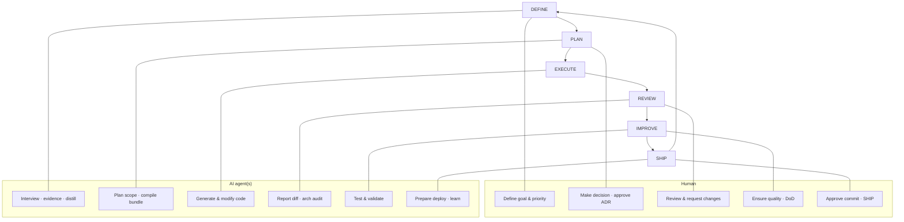
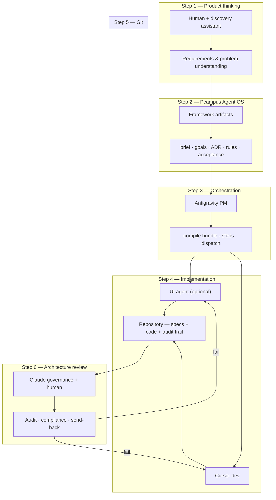

# Multi-agent operating model

> **For humans.** Narrative map of how multiple AI tools collaborate under **Pcampus Agent OS**.  
> Technical handoff spec: [coordination.md](../03-architecture/coordination.md) · Collaboration phases: [design-spec.md](../03-architecture/design-spec.md) §1

---

## Overview

**Pcampus Agent OS** is the shared framework — `AGENTS.md`, `docs/`, `.cursor/rules/`, `pcampus-*` skills, and the goal queue — not any single model or IDE.

The OS turns product intent into **development standards** every agent and human can follow. Agents **run roles** on top of the OS; they do not replace it.

> **Developers should not start from code.** Start from product design and architecture. Code is the last step.

**Multi-agent routing does not replace the Collaboration cycle.** Tool split (Claude · Antigravity · Cursor) is an **overlay** on the same Human + AI loop every Pcampus project uses. Humans still define scope, make decisions, review diffs, set the quality bar, and approve ship — agents draft, execute, test, and report. See [team-workflow.md](../06-workflows/team-workflow.md).

---

## Collaboration cycle (canonical — always on)

Every round follows **DEFINE → PLAN → EXECUTE → REVIEW → IMPROVE → SHIP**. Multi-tool setup changes *which agent runs which phase* — not whether the human participates.



| Collaboration phase | Human owns | Agent supports | Typical agent tool |
|---------------------|------------|----------------|-------------------|
| **DEFINE** | Scope, priority, sign-off on brief | Interview → evidence → PDR/digest | Governance agent + discovery assistant |
| **PLAN** | ADR approval, promote goal `ready` | Scope confirm, arch impact, compile | Governance agent · orchestrator |
| **EXECUTE** | Trigger **เริ่ม step N** (gate) | Code in touch map | Cursor · optional UI agent |
| **REVIEW** | **Approve or send back** — no auto-merge | Diff report, code-review, arch audit | Governance agent + `pcampus-code-review` |
| **IMPROVE** | Quality bar, accept test results | Run tests, fix failures | Implementer agent + `pcampus-testing` |
| **SHIP** | **Approve staging / production** | Deploy prep, smoke, rollback plan | Human + `pcampus-deploy-staging` |

Hard gates unchanged: goal `approved` before `done`; no merge to protected branches without human ([governance.mdc](../../.cursor/rules/governance.mdc)).

The six **workflow steps** below (product thinking → architecture review) are a **narrative view** of the same cycle across multiple tools — not a second process.

---

## Core philosophy

Pcampus Agent OS does not replace developers. It gives every person and every AI the **same language and standards**.

Instead of each AI improvising alone, roles are explicit:

| Role | Typical tool | Job |
|------|--------------|-----|
| Discovery assistant | External chat (project choice) | Brainstorm, problem framing, early requirements |
| **Governance agent** | Claude (Antigravity / Claude Code) | Product governance, architecture, standards — **no feature code** |
| **Orchestrator** | Antigravity | Read goals, plan work, dispatch tasks |
| **Implementer** | Cursor | Logic, API, database, integration |
| **UI implementer** | Antigravity UI *(optional consumer pattern)* | Screens, components, layout |
| **Reviewer** | Claude + **human approval** | Architecture audit, diff report — human decides |
| **Human** | — | **Define · decide · review · approve · ship** at every gate |

Record which tools your studio uses in [00-project-snapshot.md](../00-project-snapshot.md). The framework does not bind to a vendor.

---

## End-to-end workflow



Each step has a clear owner. **Do not skip order** — discussion in chat is not implementation.

Human checkpoints (non-negotiable): promote goal `ready` · trigger **เริ่ม step N** · REVIEW approve/send-back · IMPROVE sign-off · SHIP approve.

---

## Steps (mapped to collaboration phases)

Six workflow steps × six collaboration phases. **Human + AI** applies at every row — agent column is who typically drafts/executes; human column is who approves.

| Step | Agent (typical) | Human gate | Collaboration phase | Output |
|------|-----------------|------------|---------------------|--------|
| **1 Product thinking** | Discovery assistant | Human validates problem & users | DEFINE (early) | Requirements summary → evidence |
| **2 Agent OS** | Governance agent | Human accepts brief, ADR, goal `ready` | DEFINE → PLAN | brief, goals, ADR, rules, acceptance |
| **3 Orchestration** | Antigravity | Human confirms plan · **เริ่ม step N** | PLAN | `.bundle/G-xxx/`, steps, dispatch |
| **4 Implementation** | Cursor (+ optional UI) | Human monitors scope (touch map) | EXECUTE | `code/` changes |
| **5 Git + quality** | Implementer + tester agents | Human review PR · test sign-off | IMPROVE | PR, CI green, changelog |
| **6 Architecture review** | Governance agent | **Human approves** → `approved` → `done` | REVIEW (+ SHIP if deploy goal) | Audit · send-back or close goal |

Note: Step 6 is **REVIEW** in the cycle; Step 5 covers **IMPROVE** (tests/CI). SHIP remains a separate human gate when the goal includes deploy.

Skills by phase: [skills-library.md](skills-library.md) · Phase triggers in [AGENTS.md](../../AGENTS.md) · Full Human + Agent table: [team-workflow.md](../06-workflows/team-workflow.md) §1.

---

## Step 2 — What the OS produces (“project constitution”)

The governance agent **maintains consistency**. It does **not** write application code.

| Artifact | Path | Purpose |
|----------|------|---------|
| Product specification | `docs/02-product/project-brief.md` | What we build and for whom |
| Scope lock | `docs/02-product/mvp-scope.md` | In / out |
| Goals | `docs/07-backlog/goals/G-xxx.md` | Executable units of work |
| Architecture | `docs/03-architecture/`, ADR | System design decisions |
| Design principles | `docs/01-vision.md`, brief, ADR | Product and UX direction |
| Coding standards | `.cursor/rules/`, stack rules | Always-on constraints |
| Acceptance criteria | `docs/02-product/acceptance/G-xxx.md` | Testable done definition |

Governance agent entry: [CLAUDE.md](../../CLAUDE.md) · Skills: `pcampus-discovery`, `pcampus-architecture-governance`, `pcampus-goal-workflow` (spec/promote only).

---

## Step 3 — Orchestration (Antigravity)

Antigravity is the **project manager**. It does not redesign architecture — it **plans and coordinates** work from `ready` goals.

| PM concept | Pcampus artifact |
|------------|------------------|
| Goal | `docs/07-backlog/goals/G-xxx.md` |
| Epic / feature | Goal sections or linked goals with dependencies |
| Task | `step-N.md` + `action-step-N.yaml` in `.bundle/G-xxx/` |
| Priority / order | Goal dependencies + step order in bundle |
| Assignment | Human triggers **เริ่ม step N** in implementer IDE |

Antigravity bridge: [.agents/agents.md](../../.agents/agents.md) · Workflow: [.agents/workflows/arch-review.md](../../.agents/workflows/arch-review.md).

---

## Step 4 — Implementation

### Development (Cursor)

| In scope | Out of scope |
|----------|--------------|
| Business logic, API, database, integration, refactor in **touch map** | Changing architecture without ADR + governance review |
| Updating `docs/03-architecture/api/` and `data/` when contracts change | Out-of-MVP features without new goal |

Entry: [AGENTS.md](../../AGENTS.md) · Rules: `.cursor/rules/` · Execute: **เริ่ม step N** on `ready` goals only.

### UI implementer (optional consumer pattern)

Some studios run a **separate UI agent** (e.g. Antigravity UI) for screens, components, and responsive layout. This is **not** a shipped framework layer in v1.16 — it is a valid **consumer project pattern**:

- Same goal and touch map as Cursor
- UI work limited to frontend paths in the goal
- Must follow design principles from Step 2

Formalize with a project playbook or split touch maps after repeated real-world use ([os-core-invariants.md](../06-workflows/os-core-invariants.md) — evidence before new layers).

---

## Step 5 — Git repository

The repo is the **single source of truth**:

| Layer | Location |
|-------|----------|
| Specs & decisions | `docs/` |
| Application | `code/` |
| Agent config | `AGENTS.md`, `CLAUDE.md`, `.cursor/`, `.agents/` |
| Audit | `docs/07-backlog/changelog.md`, PR history |

Every change is reviewable. Agents do not merge to protected branches without human approval ([governance.mdc](../../.cursor/rules/governance.mdc)).

---

## Step 6 — Architecture review (REVIEW phase)

Claude supports **REVIEW**; the **human approves**. Agent does not close goals alone.

- Architecture still matches ADR and brief
- Coding standards and touch map respected
- Design principles not violated
- Delivery matches acceptance criteria

Triggers: `/arch-review`, `architecture review`, `arch impact` → [pcampus-architecture-governance](../../.cursor/skills/pcampus-architecture-governance/SKILL.md) + [pcampus-code-review](../../.cursor/skills/pcampus-code-review/SKILL.md).

If review fails → send back to implementer with findings. Human sets goal → `review`, then **`approved`** before `done` ([dev-loop.md](../06-workflows/dev-loop.md)).

---

## Separation of responsibilities

**Human + AI collaboration is the spine.** Tool columns show who usually runs the agent side — humans retain approval at DEFINE, PLAN, REVIEW, IMPROVE, and SHIP.

| Layer | Agent (typical) | Human gate | Responsibility |
|-------|-----------------|------------|----------------|
| Discovery | External assistant | Validate problem & evidence | Product thinking |
| **Pcampus Agent OS** (framework) | — | Own product decisions | Standards, artifacts, goal queue |
| Governance agent | Claude | Accept ADR · promote `ready` | DEFINE, PLAN, REVIEW support |
| Orchestrator | Antigravity | Confirm plan · **เริ่ม step N** | PM, task breakdown |
| UI agent *(optional)* | Antigravity UI | Review UI diff | Frontend in touch map |
| Implementer | Cursor | Touch map · PR review | Backend, logic, API, DB |
| Git | — | **Merge · commit** | Source of truth |
| Review | Claude | **`approved` → `done`** | Audit, compliance, send-back |

---

## Handoff chain (concrete artifacts)

```text
Governance (Claude)
  → docs/05-decisions/ADR-xxx.md
  → docs/07-backlog/goals/G-xxx.md  (status: ready)
  → .bundle/G-xxx/shared-memory.yaml  (architecture:)

Orchestrator (Antigravity)
  → compile G-xxx  →  step-N.md + action-step-N.yaml

Implementer (Cursor / UI agent)
  → code/  (touch map only)
  → shared-memory.yaml  (execution:)

Review (Claude + human)
  → /arch-review  →  approve or send-back
```

Full spec: [coordination.md](../03-architecture/coordination.md) · Capability scores: [agent-capabilities/capability-matrix.yaml](agent-capabilities/capability-matrix.yaml).

---

## Tool entry files

| Tool | Read first |
|------|------------|
| **All agents** | [AGENTS.md](../../AGENTS.md) |
| **Claude / Antigravity governance** | [CLAUDE.md](../../CLAUDE.md), [.agents/agents.md](../../.agents/agents.md) |
| **Antigravity skills** | [.agents/skills/](../../.agents/skills/) → symlinks to `.cursor/skills/` |
| **Cursor implementer** | `AGENTS.md`, `.cursor/rules/`, active goal |

Do not duplicate skills or rules across tools — change canonical paths only.

---

## Related

- [coordination.md](../03-architecture/coordination.md) — shared memory, playbooks, capability matrix
- [dev-roles.md](dev-roles.md) — Cursor role split (planner / implementer / …)
- [team-workflow.md](../06-workflows/team-workflow.md) — Human + Agent cycle (Mermaid)
- [design-spec.md](../03-architecture/design-spec.md) — Framework map
- [knowledge-loop.md](../06-workflows/knowledge-loop.md) — DEFINE → learning loop
